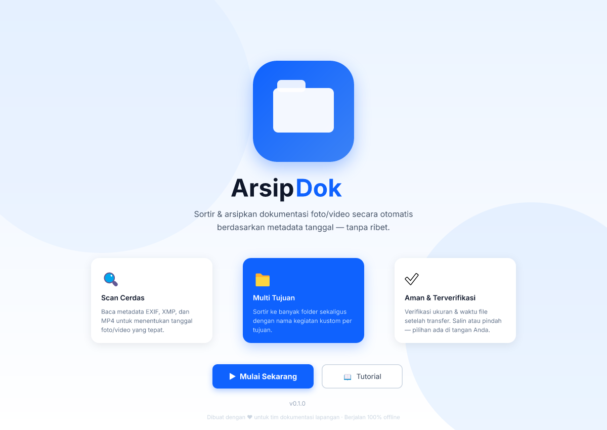

<p align="center">
  
</p>

<h1 align="center">ArsipDok</h1>

<p align="center">
  <strong>Sortir & pemindahan otomatis dokumentasi foto/video berbasis metadata — tanpa ribet.</strong>
</p>

<p align="center">
  
  
  
  
  
  
</p>

<p align="center">
  
</p>

---

## 📖 Tentang

**ArsipDok** adalah aplikasi desktop Windows (single-user, tanpa login, 100% offline) untuk **menyalin atau memindahkan** file dokumentasi foto & video dari sumber eksternal — SD card, NAS, atau drive lokal — ke folder arsip yang terstruktur secara **otomatis**.

Folder tujuan dibuat otomatis dengan format:

```text
MM-DD_Nama Kegiatan[_Suffix]
```

Tanggal diambil dari **metadata file** (EXIF/XMP untuk foto, creation time untuk video) — bukan tanggal transfer — sehingga penamaan folder selalu akurat sesuai waktu pengambilan gambar.

## ✨ Fitur Utama

| Fitur | Keterangan |
|---|---|
| 🔍 **Scan Cerdas** | Membaca metadata EXIF, XMP, dan MP4 untuk menentukan tanggal foto/video yang tepat |
| 📁 **Multi Tujuan** | Sortir ke banyak folder sekaligus dengan nama kegiatan kustom per tujuan |
| ✅ **Aman & Terverifikasi** | Verifikasi ukuran & waktu file (opsional BLAKE3) setelah transfer; mode Move hanya menghapus sumber setelah terverifikasi utuh |
| 🖥️ **Modern & Responsif** | Tema terang/gelap/ikut-sistem, mendukung Windows Snap 2-sisi (lebar minimum 620 px) |
| 📋 **Preview Tabel** | Lihat & seleksi file, override tanggal manual, filter per status sebelum transfer |
| 🧾 **Log Audit** | Catatan tiap transfer (sumber → tujuan, waktu, status) yang dapat diekspor |
| 🚀 **Cepat** | Engine transfer internal Rust, paralel per tujuan, scan 10.000 file ≤ 10 detik |

## 🚀 Instalasi

1. Unduh installer dari halaman **[Releases](https://github.com/agungwibouuo/arsipdok/releases)** → `ArsipDok_0.1.0_x64-setup.exe`
2. Jalankan installer (NSIS), ikuti langkahnya
3. Buka **ArsipDok** dari Start Menu

> Tidak ada dependensi tambahan — aplikasi berjalan standalone di Windows 10/11 x64.

## 📱 Cara Pakai

1. **Tambah Sumber** — drag & drop folder SD card / drive, atau pilih lewat dialog
2. **Atur Tujuan** — tentukan folder arsip + nama kegiatan (dan suffix bila perlu)
3. **Mulai Pindah** — periksa preview tabel, klik *Mulai Transfer*, selesai! ✅

Tersedia mode **Copy** (aman) atau **Move** (sumber dihapus setelah verifikasi).

> 📘 Panduan lengkap: **[docs/USER_GUIDE.md](docs/USER_GUIDE.md)** — instalasi, konfigurasi, override tanggal, log audit, tips & trik.

## 📚 Dokumentasi

| Dokumen | Isi |
|---|---|
| **[📘 User Guide](docs/USER_GUIDE.md)** | Panduan pengguna: instalasi, alur kerja, preview, transfer, verifikasi, log |
| **[🛠️ Developer Guide](docs/DEVELOPER.md)** | Setup dev environment, struktur kode, modul, testing, build & release |
| **[🔌 API Reference](docs/API.md)** | Spesifikasi 12 command IPC + 2 event real-time, tipe data shared schema |
| **[🏗️ Architecture](docs/ARCHITECTURE.md)** | Diagram sistem, alur pipeline, metadata flow, transfer logic, ADR |
| **[🔧 Troubleshooting](docs/TROUBLESHOOTING.md)** | Masalah umum, solusi, error reference, debug tips, FAQ |
| **[📜 Changelog](CHANGELOG.md)** | Riwayat rilis, fitur baru, known issues |

## 🛠️ Tech Stack

| Lapisan | Teknologi |
|---|---|
| Frontend | Svelte 5 + TypeScript + Vite |
| Backend | Rust (Tauri 2) — scanner, metadata (kamadak-exif), planner, transfer, verifier |
| Bindata | IPC Tauri (invoke + events) |
| Installer | NSIS via `tauri build` |
| Design | FigCraft (`design/ArsipDok.figcraft`) |

## 🔧 Development

Prasyarat: Node.js 20+, pnpm, Rust toolchain (MSVC), WebView2.

```bash
# Clone
git clone https://github.com/agungwibouuo/arsipdok.git
cd arsipdok

# Install dependensi
pnpm install
pnpm --dir ui install

# Jalankan mode development (hot reload)
pnpm tauri:dev

# Build installer release (output di src-tauri/target/release/bundle/nsis/)
pnpm tauri:build

# Tes backend (unit + e2e pipeline)
pnpm test:rust
```

> 🛠️ Panduan developer lengkap: **[docs/DEVELOPER.md](docs/DEVELOPER.md)**

### Struktur Proyek

```text
├── design/               # File design FigCraft + preview
├── docs/                 # Dokumentasi lengkap
│   ├── USER_GUIDE.md     # Panduan pengguna
│   ├── DEVELOPER.md      # Panduan pengembangan
│   ├── API.md            # Referensi IPC
│   ├── ARCHITECTURE.md   # Arsitektur sistem
│   └── TROUBLESHOOTING.md # Masalah & solusi
├── src-tauri/            # Backend Rust (Tauri 2)
│   ├── src/
│   │   ├── scanner.rs    # Pemindaian folder sumber
│   │   ├── metadata.rs   # Ekstraksi EXIF/XMP/video
│   │   ├── planner.rs    # Perencanaan struktur folder tujuan
│   │   ├── transfer.rs   # Engine copy/move paralel
│   │   ├── verifier.rs   # Verifikasi integritas (size/mtime/BLAKE3)
│   │   └── logger.rs     # Log audit per transfer
│   └── tests/            # Integration test (e2e pipeline)
├── ui/                   # Frontend Svelte 5 + TypeScript
│   └── src/lib/
│       ├── components/   # WelcomeState, SourceQueue, DestPanel, PreviewTable, dst.
│       ├── store.svelte.ts # State management (runes)
│       └── api.ts        # Wrapper IPC ke backend
├── PRD.md                # Product Requirements Document
└── package.json
```

## 🧪 Testing

```bash
pnpm test:rust   # 20+ tes: unit & e2e (scan → metadata → plan → transfer copy/move/blake3/duplikat)
```

## 🗺️ Roadmap

- [x] Fase 1 — MVP: scan, metadata, plan, transfer, verifikasi, log
- [x] Welcome screen & tema gelap/terang/sistem
- [ ] Auto-import saat SD card terdeteksi
- [ ] Ekspor log ke CSV/PDF
- [ ] Dukungan macOS/Linux

## 📄 Lisensi

[MIT](LICENSE) © ArsipDok

---

<p align="center">Dibuat dengan ❤ untuk tim dokumentasi lapangan · Berjalan 100% offline</p>
